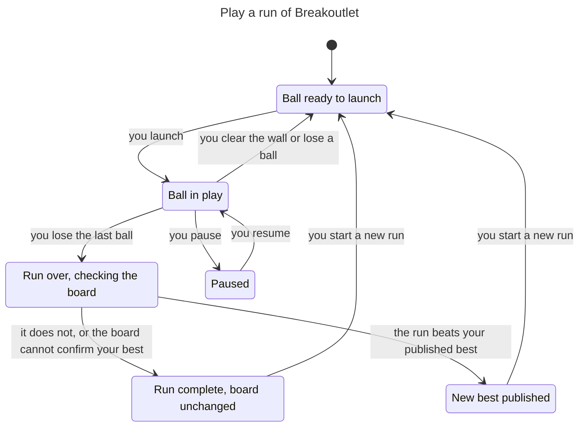

# High-score verification

| Skill | What it checks | Tool |
| --- | --- | --- |
| [verify-high-score](../../.claude/skills/verify-high-score/SKILL.md) | A published high score is never replaced by a lower one | TLA+ / TLC, 11 states |

The model found that a failed, partial or truncated leaderboard query let a low run replace the player's published best, since kind 30078 scores are addressable. The game now reads the player's own score event before publishing.

## Play a run of Breakoutlet

Generated with pstack `/statechart` from [Play.tla](flows/play-breakoutlet/Play.tla) ([TLC report](flows/play-breakoutlet/report.md)).

